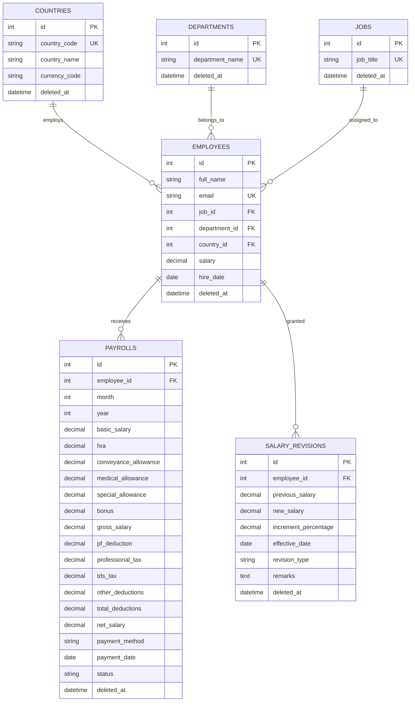

# 💼 Salary Management System — Backend API

[](https://nodejs.org/)
[](https://expressjs.com/)
[](https://sequelize.org/)
[](https://www.mysql.com/)
[](https://yarnpkg.com/)
[](LICENSE)

A robust, enterprise-grade REST API backend for managing organizational compensation, employee directory, dynamic monthly payroll calculation, salary revisions/appraisals, and real-time dashboard analytics. Built with **Node.js**, **Express 5**, **MySQL**, and **Sequelize ORM**.

---

## 📑 Table of Contents

- [Overview](#-overview)
- [Key Features](#-key-features)
- [Tech Stack](#-tech-stack)
- [System Architecture & Folder Structure](#-system-architecture--folder-structure)
- [Database Entity Relationship Diagram (ERD)](#-database-entity-relationship-diagram-erd)
- [Salary & Deduction Computation Rules](#-salary--deduction-computation-rules)
- [Prerequisites](#-prerequisites)
- [Installation & Setup](#-installation--setup)
- [Environment Configuration](#-environment-configuration)
- [Database Migrations & Seeding](#-database-migrations--seeding)
- [Running the Server](#-running-the-server)
- [API Reference](#-api-reference)
- [NPM Scripts](#-npm-scripts)
- [Requirements Specifications](#-requirements-specifications)
- [License](#-license)

---

## 🌟 Overview

The **Salary Management System Backend** powers an end-to-end human resource compensation platform. It handles employee onboarding, master data classifications (Departments, Job Roles, Countries), dynamic payroll generation with statutory breakdowns (PF, PT, TDS, HRA), appraisal increment tracking with automatic base salary synchronization, and aggregate financial metrics.

---

## 🚀 Key Features

- **👥 Employee Directory & Lifecycle**:
  - Full CRUD operations with email uniqueness constraints.
  - Relational mapping to Department, Job, and Country entities.
  - Multi-parameter search (name/email) and filtering (job, department).
  - Soft-delete support (`paranoid: true`) with `deleted_at` timestamps for historical preservation.

- **💵 Automated Monthly Payroll Engine**:
  - Auto-calculates salary earnings: **Basic (50%)**, **HRA (20%)**, **Conveyance (5%)**, **Medical (5%)**, and **Special Allowance (20%)**.
  - Auto-computes statutory deductions: **PF (12% of basic)**, **Professional Tax (₹200)**, and tiered **TDS (Income Tax)**.
  - One-click bulk payroll generation across an entire company or filtered by department with duplicate prevention.
  - Payment tracking: state transitions from `PROCESSED` to `PAID`, payment dates, and payment methods.
  - Bulk payment execution for quick reconciliation.
  - Real-time payroll financial summary (`totalGross`, `totalDeductions`, `totalNet`, `paidCount`, `processedCount`).

- **📈 Salary Revision & Appraisal Tracking**:
  - Complete historical log of salary revisions, promotions, and annual increments.
  - Automatically calculates increment percentage based on previous vs. new salary.
  - **Live Synchronization**: Recording a salary revision immediately updates the employee's current salary in the `employees` table.

- **📊 Executive Compensation Analytics & Dashboard**:
  - Total Headcount, Average Salary, True Median Salary, Minimum and Maximum Salary.
  - Segmented breakdowns by Country, Department, and Job Role with count, average, median, min, and max.
  - Dynamic 6-bucket salary distribution histogram with adaptive step sizing.

- **🌱 Massive Dataset Seeding**:
  - Bundled seeder to populate **10,000 realistic employees** across realistic global departments, jobs, and countries for load and stress testing.

---

## 🛠 Tech Stack

| Technology | Purpose |
| :--- | :--- |
| **Node.js** (`>= 18.0.0`) | JavaScript runtime environment |
| **Express.js** (`^5.3.0`) | Web application framework and REST routing |
| **MySQL2** (`^3.24.5`) | High-performance MySQL database driver |
| **Sequelize** (`^6.37.8`) | Promise-based ORM for schema, associations, and queries |
| **Sequelize CLI** (`^6.6.5`) | Database migrations and seed management |
| **dotenv** (`^18.0.7`) | Environment variable configuration loader |
| **Nodemon** (`^3.1.14`) | Development hot-reload monitor |
| **Yarn** (`>= 1.22.0`) | Deterministic package manager |

---

## 📂 System Architecture & Folder Structure

```text
backend/
├── config/
│   └── config.js                  # Sequelize database configuration (dev/test/prod)
├── migrations/                    # Database migration files
│   ├── 20261013103704-create-countries.js
│   ├── 20261014054445-create-departments.js
│   ├── 20261014054447-create-jobs.js
│   ├── 20261014054449-create-employees.js
│   ├── 20261014110001-create-payrolls.js
│   └── 20261014110002-create-salary-revisions.js
├── models/                        # Sequelize Data Models
│   ├── index.js                   # Model loader & association registry
│   ├── Country.js                 # Country entity
│   ├── department.js              # Department entity
│   ├── Employee.js                # Employee entity
│   ├── job.js                     # Job role entity
│   ├── Payroll.js                 # Monthly payroll records
│   └── SalaryRevision.js          # Salary increment audit records
├── seeders/                       # Database seeders
│   └── 20261013100149-seed-10000-employees.js  # Seeds 10,000 sample employees
├── src/                           # Business logic and REST controllers
│   ├── country/                   # Country module (controller, route, services)
│   ├── dashboard/                 # Analytics & dashboard metrics
│   ├── department/                # Department module (controller, route, services)
│   ├── employees/                 # Employee management module
│   ├── jobs/                      # Job positions module
│   ├── payroll/                   # Payroll generation, payslip & payments
│   ├── salaryRevision/            # Salary revision & appraisal service
│   └── server.js                  # Express application entry point & CORS
├── .env                           # Local environment secrets (not committed)
├── .env.example                   # Template environment variables
├── .sequelizerc                   # Sequelize CLI paths configuration
├── package.json                   # Project dependencies and npm scripts
├── requirements.txt               # Dependencies and system requirements
├── REQUIREMENTS.md                # Software Requirements Specification (SRS)
└── README.md                      # Project documentation
```

---

## 🗄 Database Entity Relationship Diagram (ERD)



---

## 🧮 Salary & Deduction Computation Rules

When generating payroll or payslips, earnings and deductions are dynamically computed using standard compensation formulas:

### 1. Gross Earnings Breakdown
| Component | Formula / Calculation | Description |
| :--- | :--- | :--- |
| **Basic Salary** | `Salary × 50%` | Primary taxable wage base |
| **HRA** | `Salary × 20%` | House Rent Allowance |
| **Conveyance Allowance** | `Salary × 5%` | Transport & travel allowance |
| **Medical Allowance** | `Salary × 5%` | Healthcare assistance |
| **Special Allowance** | `Salary - (Basic + HRA + Conveyance + Medical)` | Balancing component (~20%) |
| **Performance Bonus** | Optional custom amount or `%` | Added to gross earnings |
| **Gross Salary** | `Basic + HRA + Conveyance + Medical + Special + Bonus` | Total earnings |

### 2. Statutory Deductions
| Deduction | Rule / Formula | Description |
| :--- | :--- | :--- |
| **Provident Fund (PF)** | `Basic Salary × 12%` | Mandatory retirement deduction |
| **Professional Tax (PT)** | `₹200` if monthly salary `> 15,000`, else `0` | State professional tax |
| **TDS (Income Tax)** | • `Gross × 10%` if Annual Salary `> 1,000,000`<br>• `Gross × 5%` if Annual Salary `> 500,000`<br>• `0` otherwise | Tax Deducted at Source |
| **Other Deductions** | Custom deduction passed in payload | Unpaid leave, penalties, loans |
| **Total Deductions** | `PF + PT + TDS + Other Deductions` | Sum of all deductions |

### 3. Net Take-Home Salary
$$\mathbf{Net\ Salary} = \max(0,\ \mathbf{Gross\ Salary} - \mathbf{Total\ Deductions})$$

---

## ⚙️ Prerequisites

Ensure you have the following installed on your machine:
- **Node.js**: `v18.0.0` or higher (`v24.x` recommended)
- **Yarn** or **npm**: Yarn `1.22+` recommended
- **MySQL Server**: `v8.0+` (or MariaDB `10.5+`) running locally or remotely

---

## 📥 Installation & Setup

1. **Navigate to the Backend Directory**:
   ```bash
   cd backend
   ```

2. **Install Dependencies**:
   Using Yarn:
   ```bash
   yarn install
   ```
   Or using npm:
   ```bash
   npm install
   ```

---

## 🔐 Environment Configuration

Create a `.env` file in the `backend/` root directory (copy from `.env.example`):

```bash
cp .env.example .env
```

Configure your MySQL database credentials:

```env
PORT=5000
NODE_ENV=development

DB_HOST=localhost
DB_PORT=3306
DB_USER=root
DB_PASSWORD=your_mysql_password
DB_NAME=salary_management
DB_DIALECT=mysql
```

---

## 🗃 Database Migrations & Seeding

1. **Create the Database in MySQL**:
   ```sql
   CREATE DATABASE salary_management;
   ```

2. **Run Migrations** (creates tables and foreign keys):
   ```bash
   yarn db:migrate
   ```

3. **(Optional) Seed 10,000 Employees for Testing**:
   ```bash
   yarn db:seed
   ```

4. **Useful Migration Management Commands**:
   ```bash
   # Check migration status
   yarn db:migrate:status

   # Rollback last migration
   yarn db:migrate:undo

   # Rollback all seed data
   yarn db:seed:undo
   ```

---

## 🏃 Running the Server

### Development Mode (with hot reloading via Nodemon):
```bash
yarn dev
```

### Production Mode:
```bash
yarn start
```

Once running, the API server will be live at:
```text
http://localhost:5000
```
Health Check:
```bash
curl http://localhost:5000/api
```
Response:
```json
{
  "success": true,
  "message": "Backend is running successfully!"
}
```

---

## 📡 API Reference

Base URL: `http://localhost:5000/api`

### 1. Employees (`/api/employees`)
| Method | Endpoint | Query / Body Parameters | Description |
| :--- | :--- | :--- | :--- |
| `GET` | `/` | `page`, `limit`, `name`, `job`, `department` | Fetch paginated employees list with filtering and search |
| `GET` | `/:employee_id` | - | Fetch single employee details with associations |
| `POST` | `/add` | `{ full_name, email, job_title, department, country_id, salary, hire_date }` | Add new employee |
| `PUT` | `/update` | `{ employee_id, full_name, email, job_title, department, country_id, salary, hire_date }` | Update existing employee |
| `DELETE` | `/:employee_id` | - | Soft-delete employee (`deleted_at`) |

### 2. Payroll Operations (`/api/payroll`)
| Method | Endpoint | Query / Body Parameters | Description |
| :--- | :--- | :--- | :--- |
| `GET` | `/` | `page`, `limit`, `month`, `year`, `status`, `department_id`, `employee_id`, `search` | List payrolls with filter, search, and aggregate summary metrics |
| `GET` | `/:id` | - | Get detailed payslip breakdown for payroll record |
| `POST` | `/generate` | `{ month, year, department_id?, bonus_percentage? }` | Auto-generate monthly payroll for all or departmental employees |
| `POST` | `/create` | `{ employee_id, month, year, bonus?, other_deductions?, payment_method?, status?, remarks? }` | Create manual payroll entry |
| `PUT` | `/:id` | `{ bonus?, other_deductions?, status?, payment_method?, remarks? }` | Update payroll record |
| `POST` | `/:id/pay` | `{ payment_method?, payment_date? }` | Mark single payroll entry as `PAID` |
| `POST` | `/bulk-pay` | `{ month?, year?, department_id?, payment_method? }` | Bulk mark all matching payroll records as `PAID` |
| `DELETE` | `/:id` | - | Soft-delete payroll record |

### 3. Salary Revisions (`/api/salary-revisions`)
| Method | Endpoint | Query / Body Parameters | Description |
| :--- | :--- | :--- | :--- |
| `GET` | `/` | `page`, `limit`, `employee_id`, `search` | Get salary revision logs with pagination and search |
| `POST` | `/add` | `{ employee_id, new_salary, effective_date, revision_type, remarks }` | Record appraisal / increment and **synchronize employee base salary** |
| `DELETE` | `/:id` | - | Delete salary revision record |

### 4. Executive Analytics & Dashboard (`/api/dashboard`)
| Method | Endpoint | Query Parameters | Description |
| :--- | :--- | :--- | :--- |
| `GET` | `/` | - | Retrieve aggregate headcount, average/median/min/max salary, grouped metrics by department, job, country, and dynamic 6-bucket distribution |

### 5. Master Data (`/api/department`, `/api/job`, `/api/country`)
| Entity | Methods | Endpoints | Description |
| :--- | :--- | :--- | :--- |
| **Department** | `GET`, `POST`, `PUT`, `DELETE` | `/api/department`, `/api/department/:id`, `/api/department/add`, `/api/department/update` | Manage organizational departments |
| **Job Role** | `GET`, `POST`, `PUT`, `DELETE` | `/api/job`, `/api/job/:id`, `/api/job/add`, `/api/job/update` | Manage job titles and designations |
| **Country** | `GET`, `POST`, `PUT`, `DELETE` | `/api/country`, `/api/country/:id`, `/api/country/add`, `/api/country/update` | Manage operating countries and currencies |

---

## 📜 NPM Scripts

| Command | Description |
| :--- | :--- |
| `yarn dev` | Start development server with Nodemon auto-restart |
| `yarn start` | Start standard production server |
| `yarn db:migrate` | Execute pending database migrations |
| `yarn db:migrate:undo` | Revert the most recent database migration |
| `yarn db:migrate:status` | Display migration execution history |
| `yarn db:migration:create` | Generate a new Sequelize migration template |
| `yarn db:seed` | Seed database with 10,000 realistic employee records |
| `yarn db:seed:undo` | Revert all executed database seeders |

---

## 📄 Requirements Specifications

For detailed functional specifications, system prerequisites, and dependency versions, refer to:
- **[REQUIREMENTS.md](file:///d:/surprise%20assessment/backend/REQUIREMENTS.md)**: Full Software Requirements Specification (SRS) covering Functional Requirements (FRs), Non-Functional Requirements (NFRs), and architectural guarantees.
- **[requirements.txt](file:///d:/surprise%20assessment/backend/requirements.txt)**: Version-pinned dependency requirements.

---

## 📄 License

This project is licensed under the [MIT License](LICENSE).