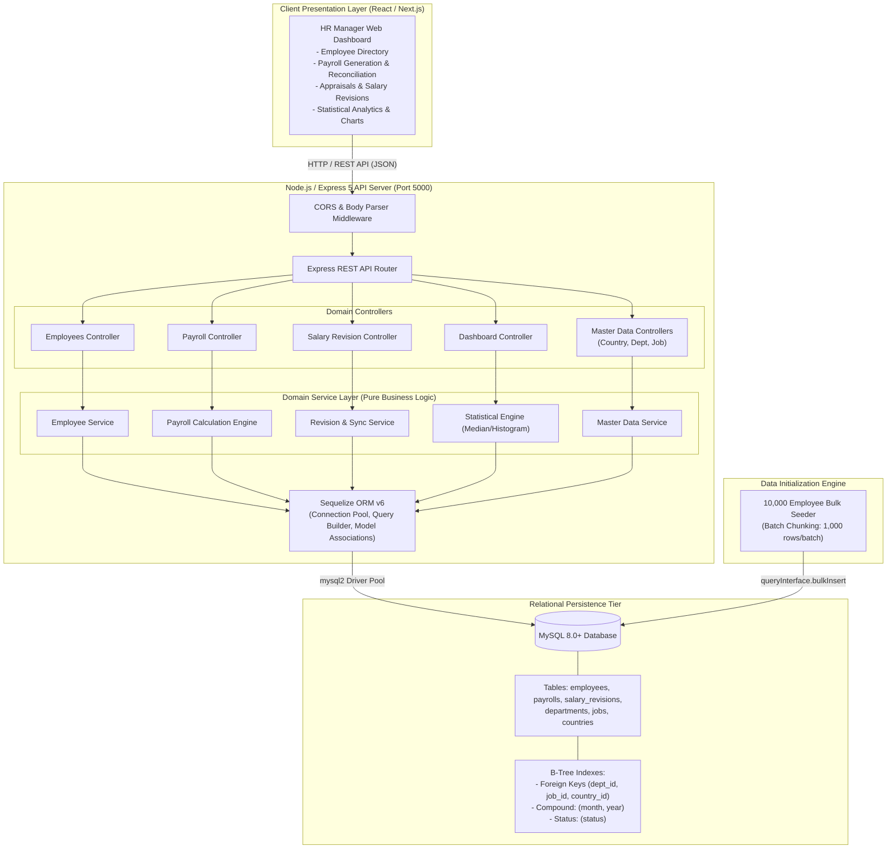
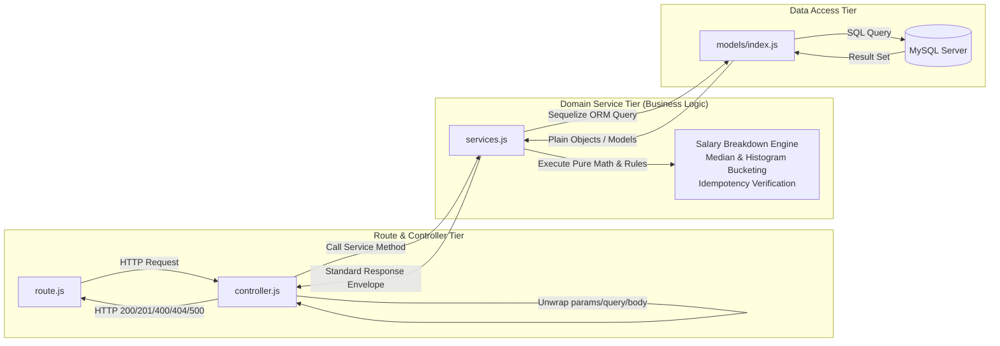
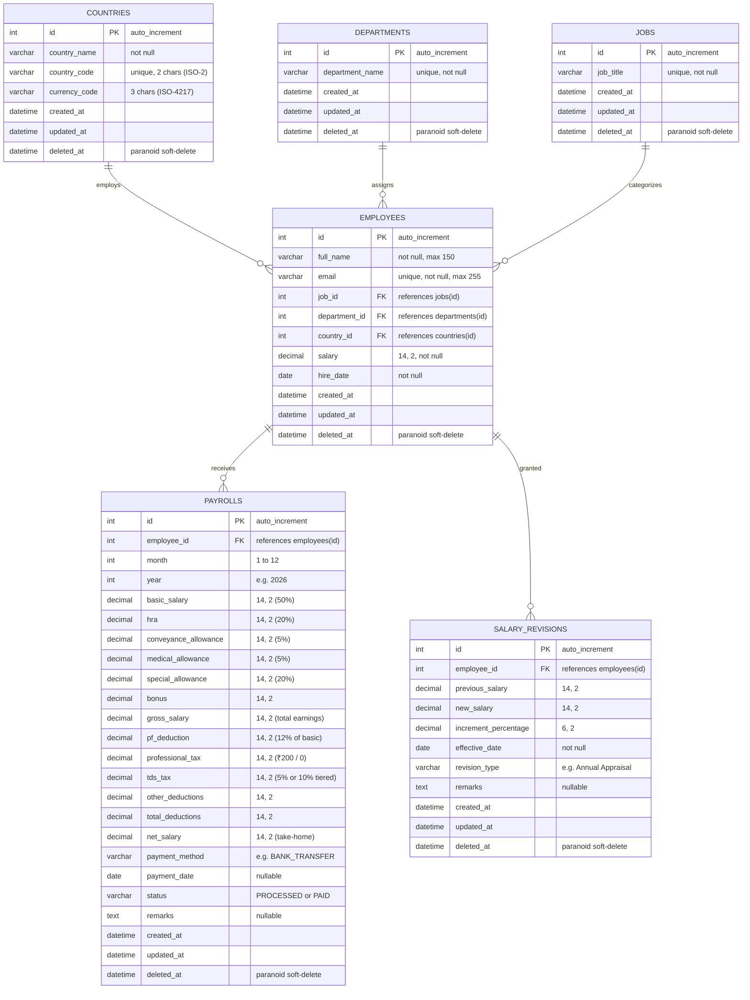
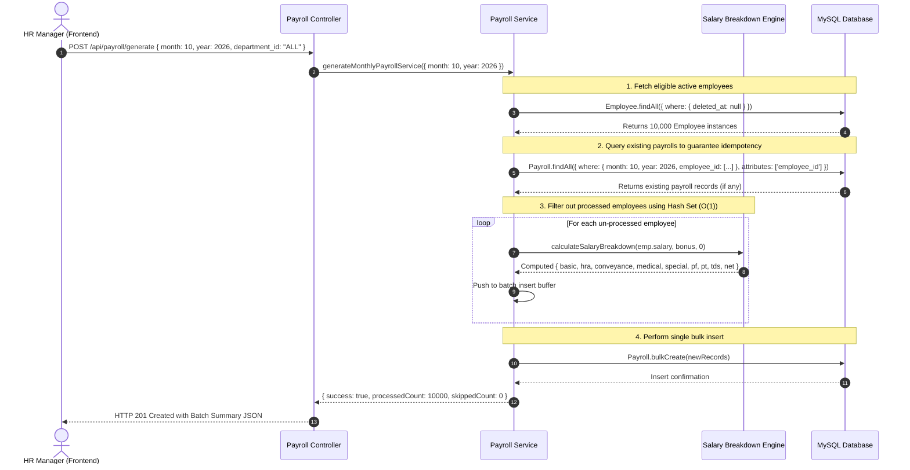
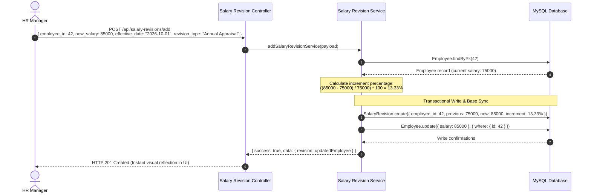
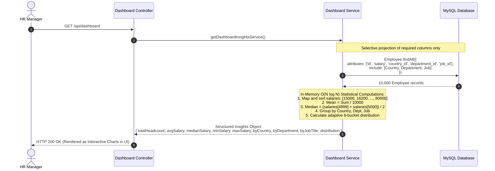
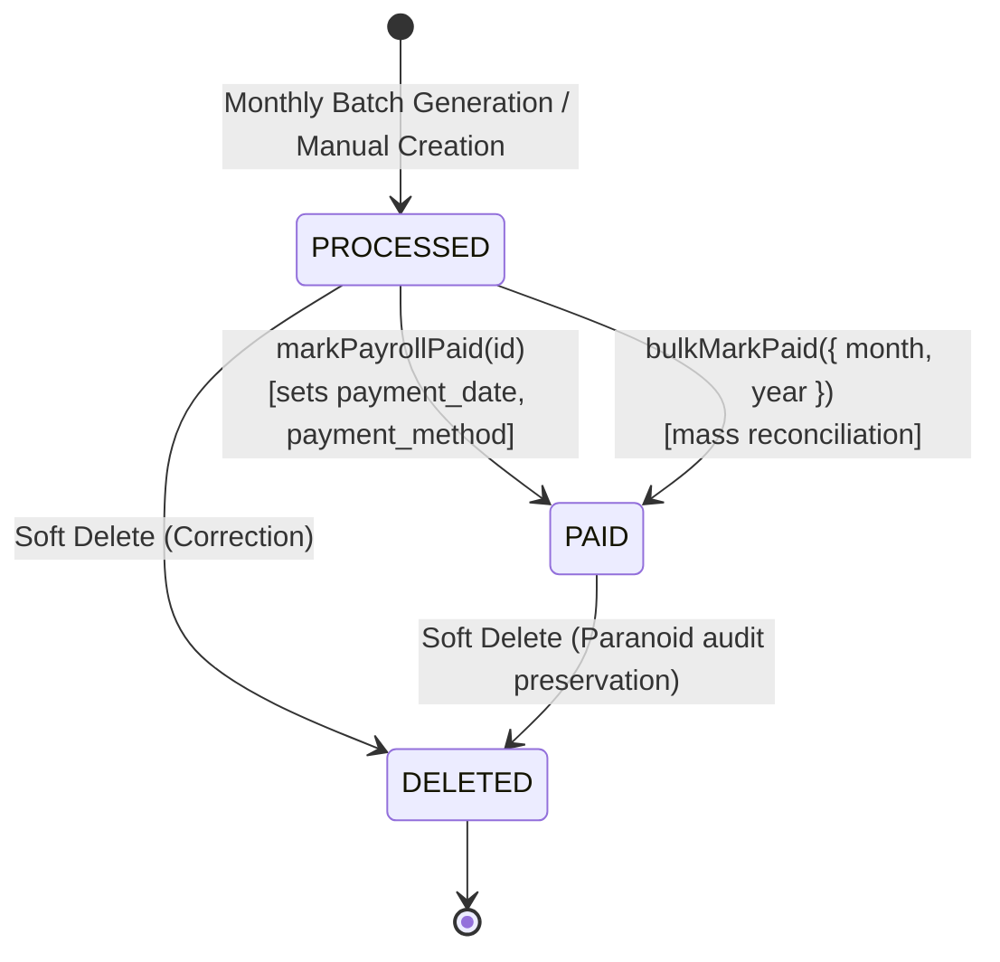

# 🏗 System Architecture & Technical Diagrams: Salary Management Backend

This document details the architectural blueprints, component topologies, entity relationships, and runtime sequence interactions powering the **Salary Management System Backend**.

All diagrams are authored in GitHub-compliant **Mermaid** syntax for dynamic visualization and long-term version control.

---

## 1. High-Level System Topology

The system uses a decoupled client-server architecture. The backend exposes stateless RESTful APIs over HTTP/JSON consumed by a modern Single Page Application (SPA), backed by a relational MySQL 8 database.

---

## 2. Layered Clean Architecture (Module Internals)

Every domain follows a strict unidirectional data flow: **Route ➔ Controller ➔ Service ➔ Model ➔ Database**.

---

## 3. Entity-Relationship Diagram (ERD)

The relational schema is normalized to 3NF, enforcing referential integrity while providing soft-delete auditability across all tables.

---

## 4. Sequence Diagram: Monthly Batch Payroll Generation

Demonstrates how the HR Manager triggers a monthly payroll run for 10,000 employees with deduplication and bulk generation.

---

## 5. Sequence Diagram: Salary Revision & Automatic Base Salary Synchronization

Shows how an appraisal record is logged and immediately synchronizes the live employee base salary.

---

## 6. Sequence Diagram: Real-Time Executive Dashboard Insights

Illustrates how the statistical engine calculates headcount, mean, true median, and adaptive histogram buckets for 10,000 employees in sub-50 milliseconds.

---

## 7. State Transition Diagram: Payroll Record Lifecycle

