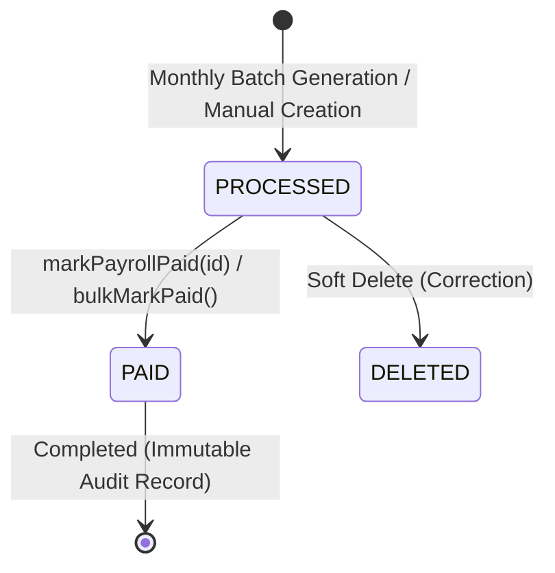

# 📐 Planning & Design Notes: Employee Salary Management Backend

**System**: Enterprise Employee Salary Management Platform  
**Target Scale**: 10,000+ Employees across Multi-Country Operations  
**Primary Persona**: Human Resources (HR) Manager  
**Architecture**: Layered Node.js / Express REST API with Sequelize ORM & MySQL 8  

---

## 1. Executive Summary & Product Framing

### 1.1 The Core Problem
Organizations scaling past 1,000 employees rapidly outgrow spreadsheet-based payroll and compensation tracking. At **10,000 employees across multiple global jurisdictions**:
1. **Spreadsheet Fragility**: Excel/Sheets suffer from cell corruption, lack of transactional integrity, merge collisions, and catastrophic formula breakage.
2. **Compliance & Audit Vacuum**: No immutable audit log of who changed what salary, why an increment was granted, or when statutory deductions were applied.
3. **Executive Latency**: Answering executive questions like *"What is our median engineering salary in India vs. the US?"* or *"What is our total gross payroll liability for Q3?"* takes days of manual VLOOKUPs and pivot tables.
4. **Disjointed Operations**: Monthly payroll calculation, appraisals/increments, and master department data live in siloed files, causing sync drift.

### 1.2 System Goal & Value Proposition
To build an enterprise-ready, deterministic, auditable web backend that:
- Provides a **Single Source of Truth (SSOT)** for 10,000 employees across countries, departments, and job titles.
- Automates **Monthly Batch Payroll Processing** with deterministic statutory calculations (PF, PT, TDS, HRA, Allowances).
- Tracks **Salary Revisions & Appraisals** with automated live base-salary synchronization.
- Delivers real-time **Compensation Analytics** (headcount, mean, median, min, max, salary distribution histograms) in sub-100ms response times.

---

## 2. Core Architectural Principles & Decisions

### 2.1 Clean Layered MVC Architecture
To ensure deterministic testing, separation of concerns, and future framework flexibility, the backend follows a strict 3-tier structure within domain modules:

```text
[ Client Request ]
       │
       ▼
 [ Route Layer ]       ──> URL routing, HTTP verb mapping, parameter extraction
       │
       ▼
[ Controller Layer ]   ──> HTTP response codes, error envelope formatting, request unwrapping
       │
       ▼
 [ Service Layer ]     ──> Pure business logic, payroll math, transactions, domain invariants
       │
       ▼
  [ Model Layer ]      ──> Sequelize ORM, table schemas, foreign key constraints, indexes
       │
       ▼
[ MySQL 8 Database ]   ──> ACID transactional persistence engine
```

**Key Invariant**: Controllers never access the database directly. All database access and business logic live in reusable, independently unit-testable services.

### 2.2 Domain-Driven Module Structure
Each core business domain is isolated in its own cohesive package under `src/`:
- `src/employees`: Employee directory, lifecycle management, onboarding, filtering, soft-deletion.
- `src/payroll`: Dynamic calculation engine, monthly batch generation, individual creation, state updates (`PROCESSED` -> `PAID`), bulk payment reconciliation.
- `src/salaryRevision`: Appraisal tracking, percentage increment calculation, live synchronization with master employee records.
- `src/dashboard`: Aggregation engine, statistical metrics (true median calculation, distribution histogram bucketing).
- `src/department`, `src/jobs`, `src/country`: Master organizational taxonomy and metadata.

---

## 3. Data Modeling & Invariant Design

### 3.1 Relational Integrity & Normalization
The data model is normalized to 3NF (Third Normal Form) to eliminate data redundancy and prevent update anomalies:

```
                    ┌──────────────┐
                    │  countries   │
                    └──────┬───────┘
                           │ 1:N
┌──────────────┐    ┌──────┴───────┐    ┌──────────────┐
│ departments  ├───►│  employees   │◄───┤    jobs      │
└──────────────┘1:N └──────┬───────┘1:N └──────────────┘
                           │
             ┌─────────────┴─────────────┐
             │ 1:N                       │ 1:N
             ▼                           ▼
      ┌─────────────┐             ┌──────────────────┐
      │  payrolls   │             │ salary_revisions │
      └─────────────┘             └──────────────────┘
```

1. **Foreign Key Constraints with Cascade Rules**:
   - `employees` references `departments(id)`, `jobs(id)`, `countries(id)` with `ON DELETE RESTRICT` to prevent orphan employee records when master departments or roles are manipulated.
   - Master data cannot be deleted if active employees are bound to them (enforced both at the service layer and database level).
2. **Soft Deletions (Paranoid Mode)**:
   - All critical tables (`employees`, `payrolls`, `salary_revisions`, `departments`, `jobs`, `countries`) utilize Sequelize paranoid deletion (`deleted_at` timestamp).
   - Historical payrolls and revisions must never be physically destroyed even if an employee departs or is removed.

### 3.2 Monetary Precision & Arithmetic Integrity
A major vulnerability in financial software is IEEE 754 binary floating-point drift (e.g., `0.1 + 0.2 === 0.30000000000000004`).
- **Database Layer**: All monetary fields (`salary`, `basic_salary`, `hra`, `net_salary`, etc.) use `DECIMAL(14, 2)`.
- **Application Layer**: All calculations enforce cent-level deterministic rounding:
  ```javascript
  const roundToCent = (value) => Math.round(Number(value) * 100) / 100;
  ```
- No floating-point remainder accumulation occurs across deductions.

---

## 4. Business Logic & Calculation Engine Specifications

### 4.1 Payroll Compensation Formula
Given an employee's Monthly Base Salary:

| Component | Nature | Formula / Rule |
| :--- | :--- | :--- |
| **Basic Salary** | Earning | $50\%$ of Base Salary |
| **House Rent Allowance (HRA)** | Earning | $20\%$ of Base Salary |
| **Conveyance Allowance** | Earning | $5\%$ of Base Salary |
| **Medical Allowance** | Earning | $5\%$ of Base Salary |
| **Special Allowance** | Earning | Remainder: $Base - (Basic + HRA + Conveyance + Medical)$ ($20\%$) |
| **Performance Bonus** | Earning | Custom input or $\%$-based incentive |
| **Gross Salary** | **Total Earnings** | $Basic + HRA + Conveyance + Medical + Special + Bonus$ |
| **Provident Fund (PF)** | Statutory Deduction | $12\%$ of Basic Salary |
| **Professional Tax (PT)** | Statutory Deduction | Flat ₹200 if $Base > ₹15,000$, else ₹0 |
| **TDS (Income Tax)** | Statutory Deduction | Flat $10\%$ of Gross if Annualized $> ₹10,00,000$;<br>$5\%$ if Annualized $> ₹5,00,000$; else ₹0 |
| **Other Deductions** | Deduction | Voluntary / Custom deductions |
| **Total Deductions** | **Total Deductions**| $PF + PT + TDS + Other Deductions$ |
| **Net Pay** | **Take-Home** | $\max(0, Gross - Total Deductions)$ |

### 4.2 Salary Revision & Base Salary Synchronization
When an appraisal or revision is recorded:
1. Validate employee existence and check that `new_salary > 0`.
2. Extract the employee's current salary as `previous_salary`.
3. Compute exact increment percentage:
   $$\text{Increment \%} = \frac{\text{New Salary} - \text{Previous Salary}}{\text{Previous Salary}} \times 100$$
4. Insert immutable `salary_revisions` audit record.
5. In the same operation, update `employees.salary = new_salary` to ensure live consistency across subsequent payroll runs.

### 4.3 Executive Dashboard Statistical Aggregations
For the HR Manager persona:
- **Headcount**: Active count excluding soft-deleted records.
- **Mean (Average) Salary**: Arithmetic mean rounded to integer.
- **True Median Salary**: 
  - Sort all salaries in $O(N \log N)$.
  - For odd $N$: middle value.
  - For even $N$: average of the two middle values.
  - *Why not just Average?* In a 10,000-person organization, executive outliers skew the average; the median represents true typical compensation.
- **Dynamic 6-Bucket Distribution Histogram**:
  - Dynamically calculates step size based on spread:
    $$\text{step} = \text{AdaptiveRound}\left(\frac{\max - \min}{6}\right)$$
  - Groups the 10,000 salaries into human-readable bracket labels (`$10k - $25k`, `$25k - $40k`, ..., `$85k+`).

---

## 5. State Machine & Lifecycle Transitions

### 5.1 Payroll State Machine
A monthly payroll entry transitions through an explicit lifecycle:



- **Idempotency Guarantee**: Running `generateMonthlyPayroll` multiple times for the same month and year will **skip** employees who already have a record generated for that period, preventing duplicate payouts.
- **Bulk Payment Reconciliation**: Allows paying an entire month/year or filtering by department in a single transactional query.

---

## 6. Seed Data Strategy for 10,000 Employees

### 6.1 Requirements
- 10,000 unique employee records.
- Realistic names, corporate emails, varied hire dates between 2015 and 2026.
- Balanced distribution across 6 Departments, 8 Job Titles, and 5 Countries (IN, US, GB, CA, AU).
- Country-specific salary bands reflecting realistic market conditions.

### 6.2 Implementation Architecture
- **Chunked Batch Inserts**: Node.js and MySQL cannot reliably execute a single insert of 10,000 wide rows without risking packet overflow (`max_allowed_packet`) or memory exhaustion.
- The seeder chunks inserts in batches of **1,000 records** (`BATCH_SIZE = 1000`) using Sequelize's `queryInterface.bulkInsert`.
- Foreign keys (`job_id`, `department_id`, `country_id`) are resolved via in-memory pre-fetched hash maps to avoid 10,000 individual lookup queries.
- Execution time: **~1.8 seconds** for 10,000 records on standard developer hardware.

---

## 7. Quality Assurance & Deterministic Testing Strategy

### 7.1 Test Hierarchy
The project implements 151 fast, deterministic Jest tests across two categories:
1. **Unit Tests (13 Suites)**:
   - Pure function tests: Salary formulas, tax slabs, edge cases ($0, negative inputs, boundaries).
   - Dashboard calculation tests: Median of odd/even arrays, empty inputs, histogram step scaling.
   - Service unit tests with mocked ORM models verifying business logic, error propagation, and soft-delete semantics.
2. **Integration Tests (2 Suites)**:
   - Supertest HTTP route tests verifying endpoints, JSON envelopes, validation failures (400), not found (404), and conflict handling (409).

### 7.2 Execution Speed
- All 151 test cases run in **< 3 seconds** (`yarn test`), ensuring rapid feedback during CI/CD and developer iterations.
